# Modes, with screenshots

Each mode is an opt-in library. Games turn them on in `game.toml` (`libs = "rpg, minigames"`); the JavaScript
modules load the first time a game uses them, so a plain dialogue game stays small. All images are made by
`python3 tools/docshots.py` from the games in `games/`.

## Dialogue and menus (core)

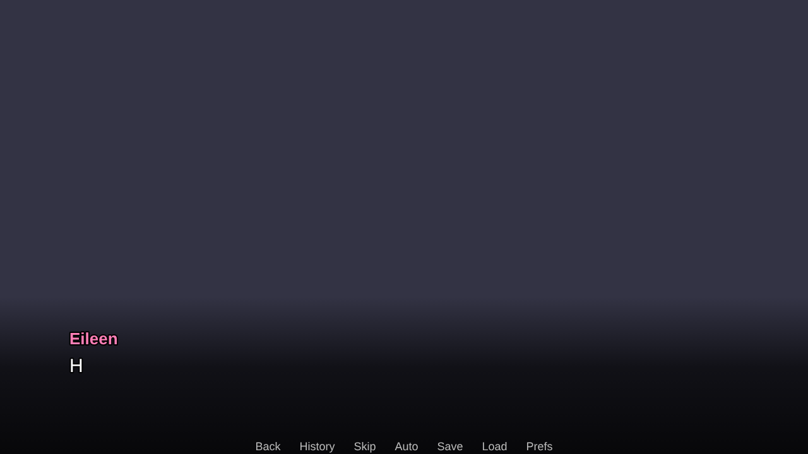

`say`, `menu`, text tags (`{w}`, `{wave}`, `{color}`), rollback, history, skip/auto, saves. Every default screen in
`engine/stdlib.rpy` can be overridden by defining a screen of the same name.

```renpy
define e = Character("Eileen", who_color="#c8ffc8")
label start:
    scene bg dusk with fade
    e "Hello!{w=0.3} {wave}Nice.{/wave}"
    menu:
        "More points":
            $ points += 10
```

## TileMap: top-down scroller (`tiles.js`)

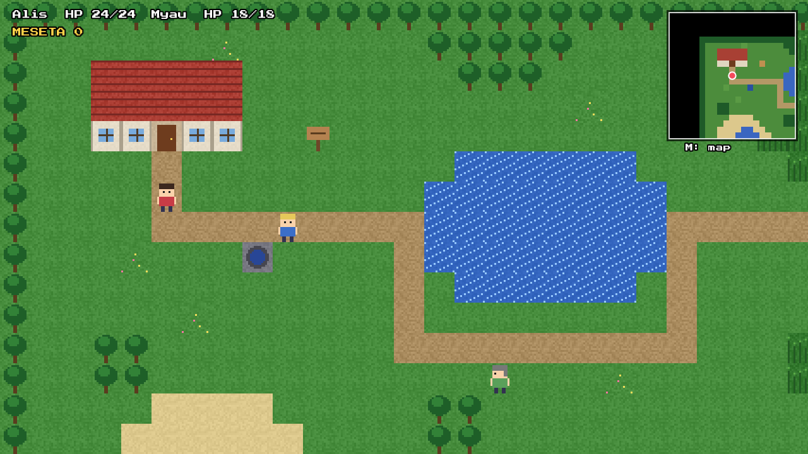


Smooth grid steps, 4-way character sheets, NPCs, tap-to-walk and optional wall-shadowed lighting. `MapView` draws
the minimap, and the same widget fills the screen in map mode (`M`):

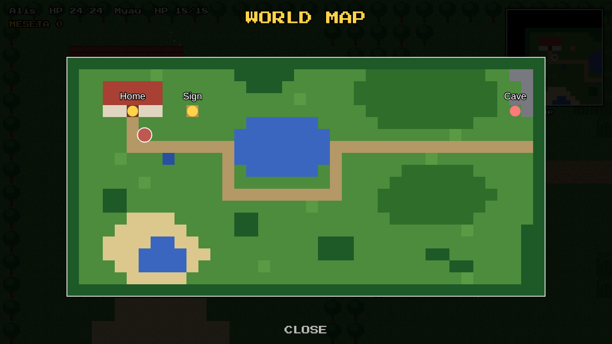

```renpy
screen overworld():
    add TileMap("world", state="pos", tileset=Tileset("tiles.png"), player=CharSheet("people.png"),
                npcs=npcs_here(), light=light_here()) action Function(map_event)
    add MapView("world", state="pos", radius=10) pos (1060, 20) xysize (200, 200)
```

## Battles and RPG basics (`lib/rpg.rpy`)

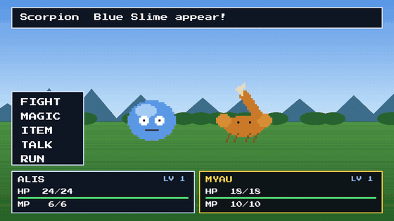

Party, items, spells, XP and gold, with first-person battles in the Phantasy Star style:

```renpy
label fight:
    $ start_battle(["slime", "scorpion"], bg="bg_field.jpg")
    call battle
```

## Lighting (`light.js`)

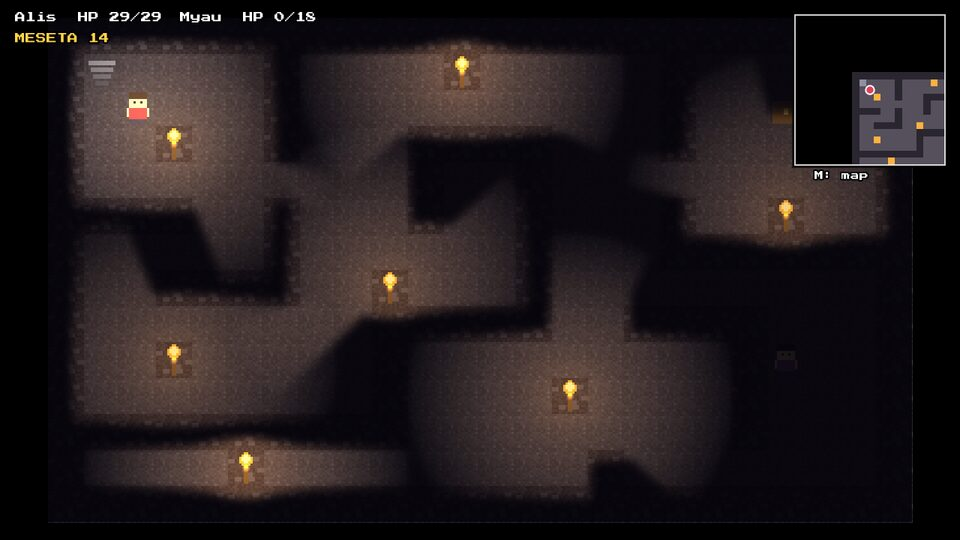

Darkness, flickering coloured lights, ray-cast shadows and dust, as a displayable (`LightMap`, `Light`). In
`games/jade-vault` the `L` key cycles black, dim and lit:

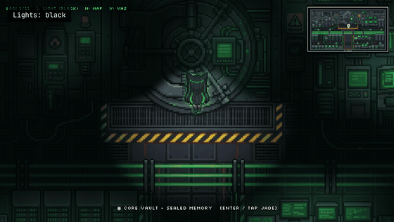

## Tour: faux-3D interiors (`tour.js`)

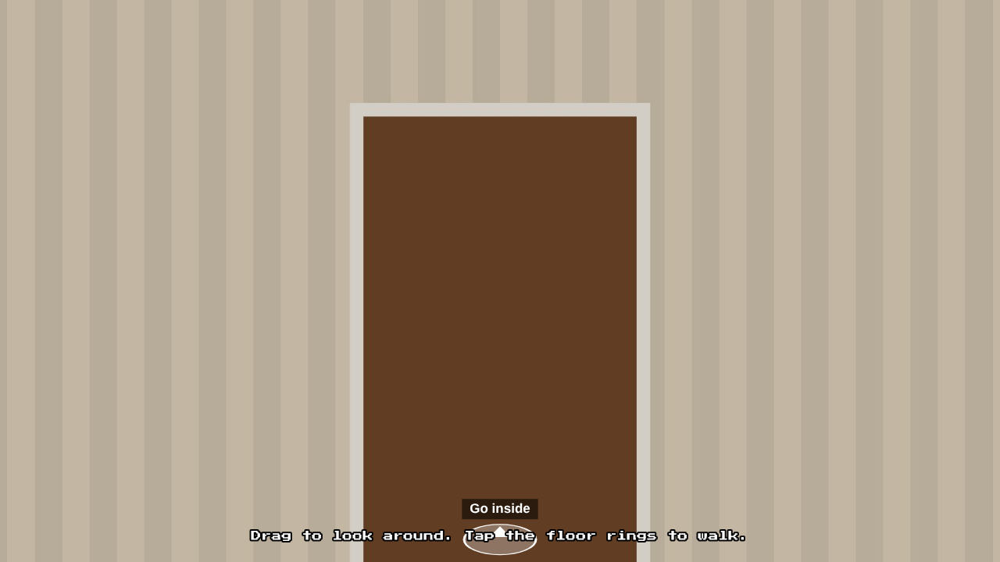
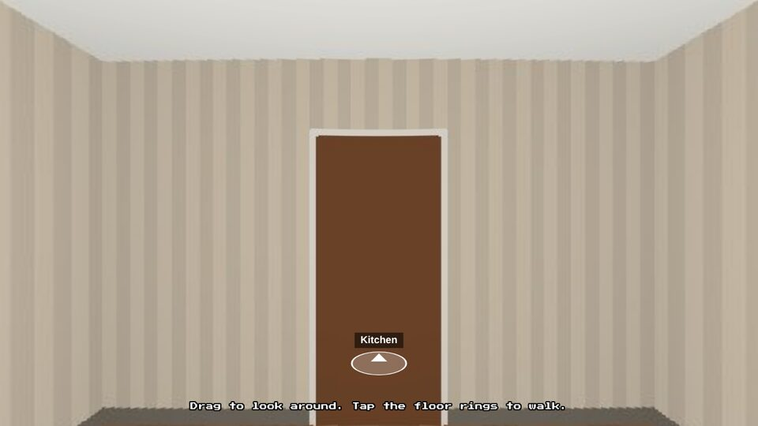
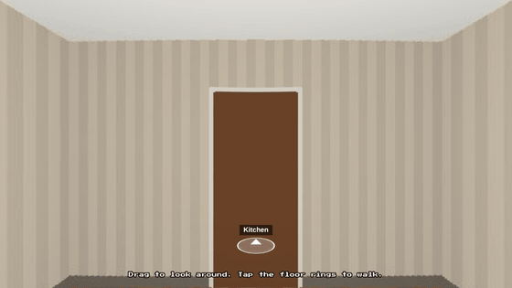

Real-estate-tour style rooms from 360° or flat snapshots: drag to look, tap the floor rings to walk.

```renpy
screen house():
    add Tour("house", state="tour_pos") action Function(tour_event)
```

## Minigames (`lib/minigames.rpy`)

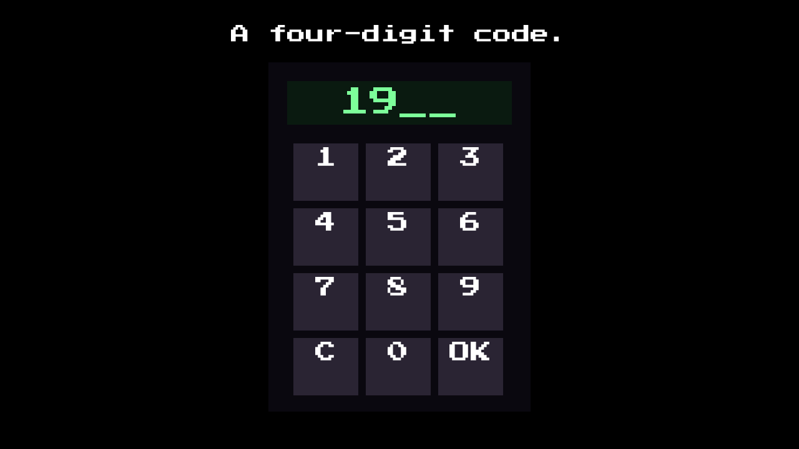

`qte`, `mash`, lockpick timing, keypad, memory, sliding puzzle, simon.

```renpy
$ mg_setup("keypad", code="1987")
call screen minigame
```

## Image maps (Jade's Vault)

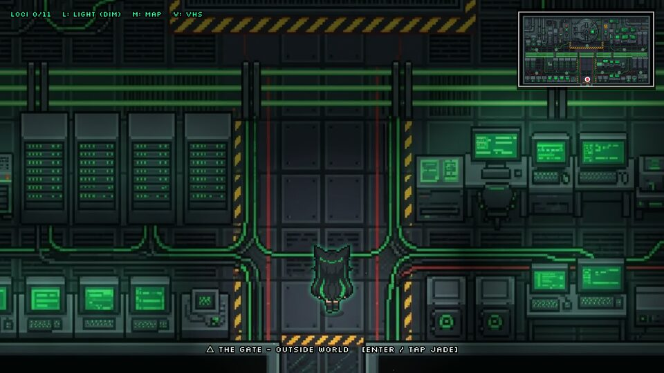
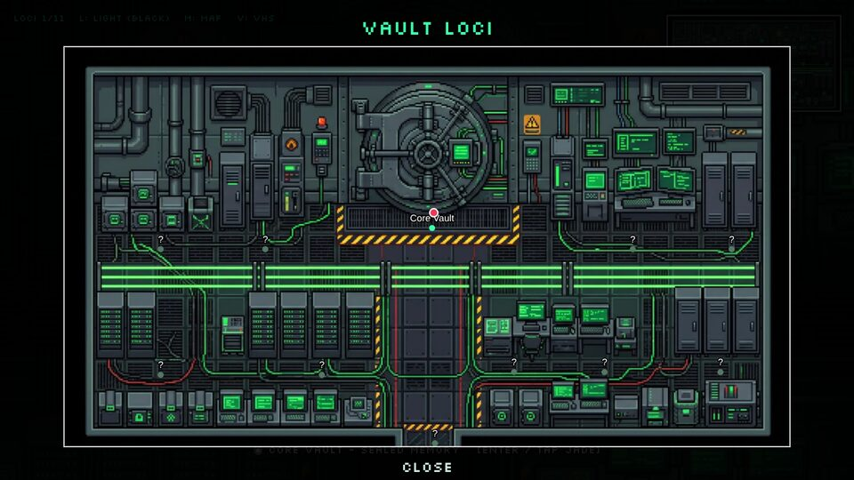

`games/jade-vault` walks Jade through Vault Loci's painted vault: `map_from_rects` turns painted rectangles into a
walkable map and `FrameSheet` handles tall sprites.

## Live2D (`live2d.js`)

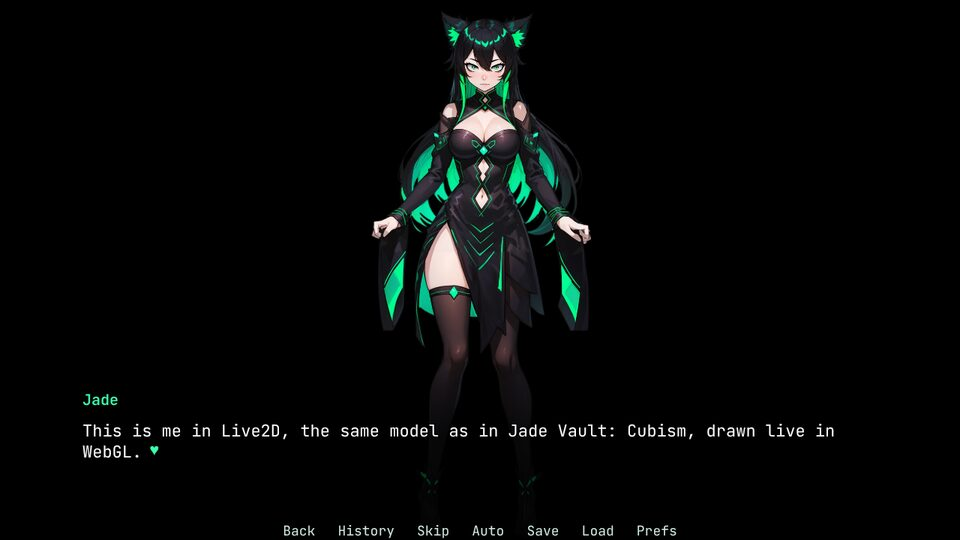

Cubism 4/5 on WebGL: masks, blend modes, motions, blink, breathing, look-at, voice lip-sync, expressions, poses.
Above: Jade, Jade Vault's own model (`games/jade-vault/assets/jade-live2d/`). The Cubism Core is Live2D's licensed runtime
and is not bundled: point `config.live2d_core` at Live2D's copy, or run `sh games/jade-vault/tools/fetch_live2d.sh` for an
offline one.

```renpy
define config.live2d_core = "https://cubism.live2d.com/sdk-web/cubismcore/live2dcubismcore.min.js"
image jade live2d = Live2D("jade-live2d/jadecat.model3.json", id="jade", motion=None, look="mouse")
```

## Post effects (`fx.js`)

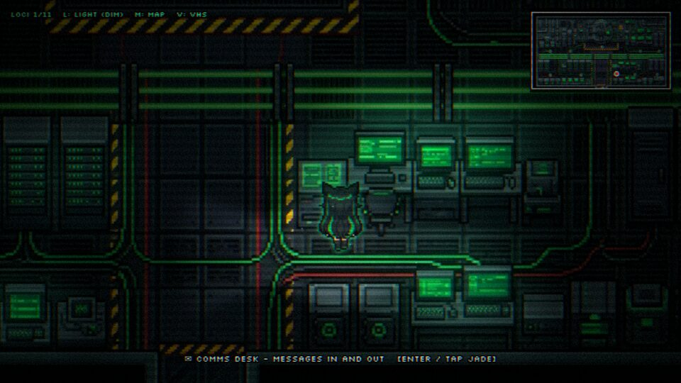

WebGL effects (`vhs`, `crt`, `glitch`, `rgbshift`, `thermal`, colour grades and 3D LUTs, `vectoria`). One call:
`$ renpy.fx("rgbshift", amount=0.006, duration=0.8)`.

## From Jade Agent Stack and jade-edu

Jade Agent Stack scaffolds, checks and builds these games with `jade vn new`, `jade vn check` and
`jade vn build`; jade-edu can run a built game as a sandboxed webxdc lab inside a course.
